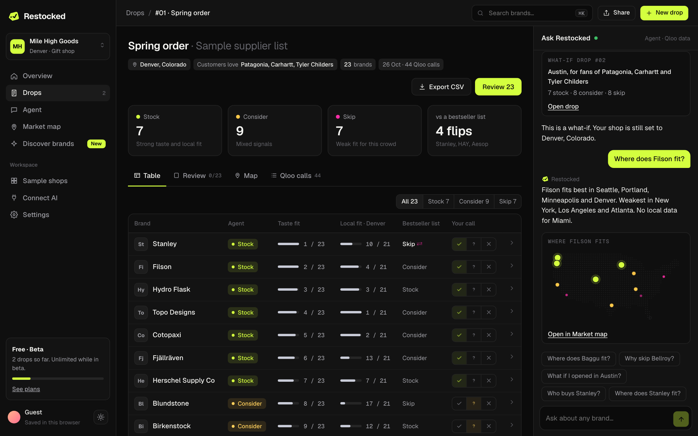
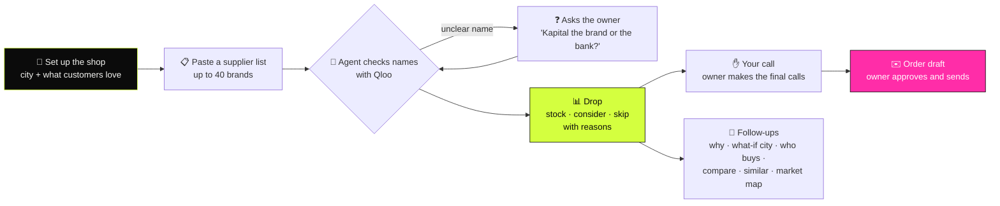
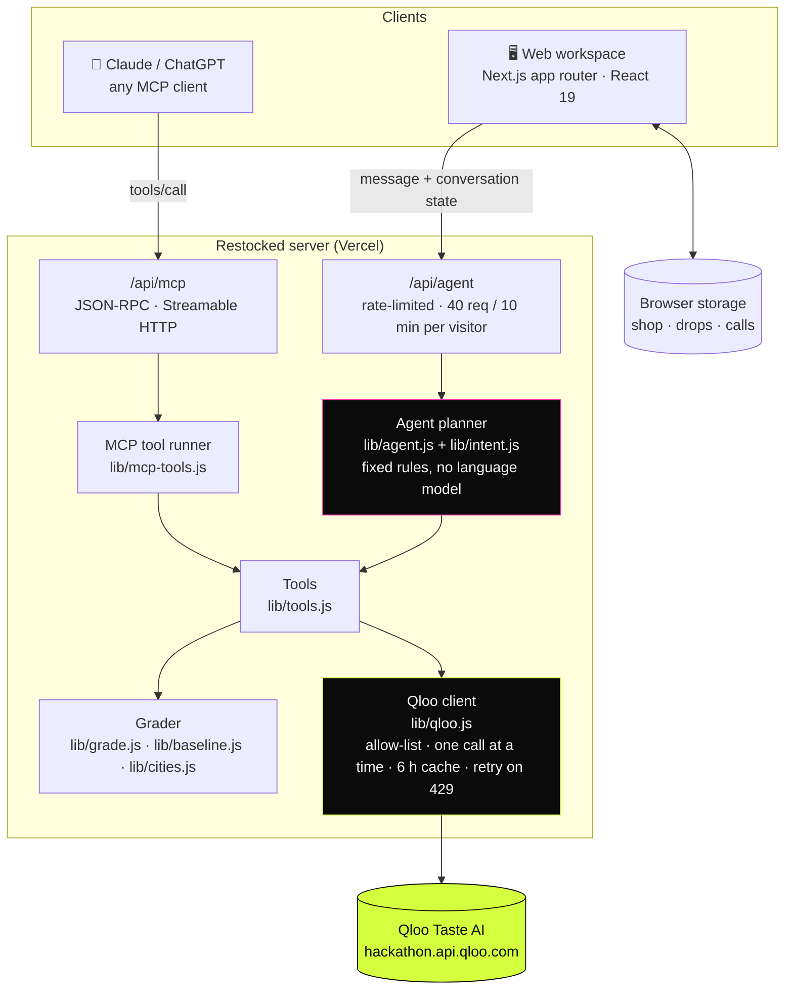
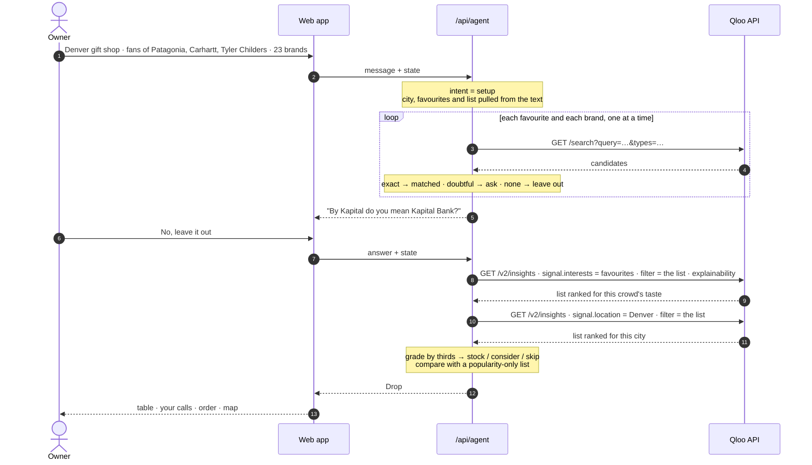
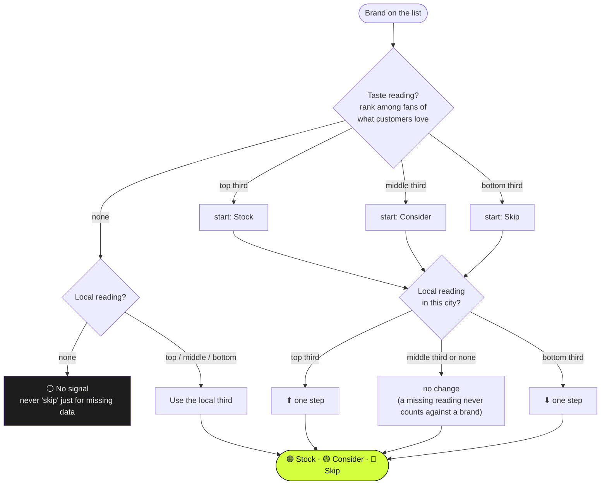
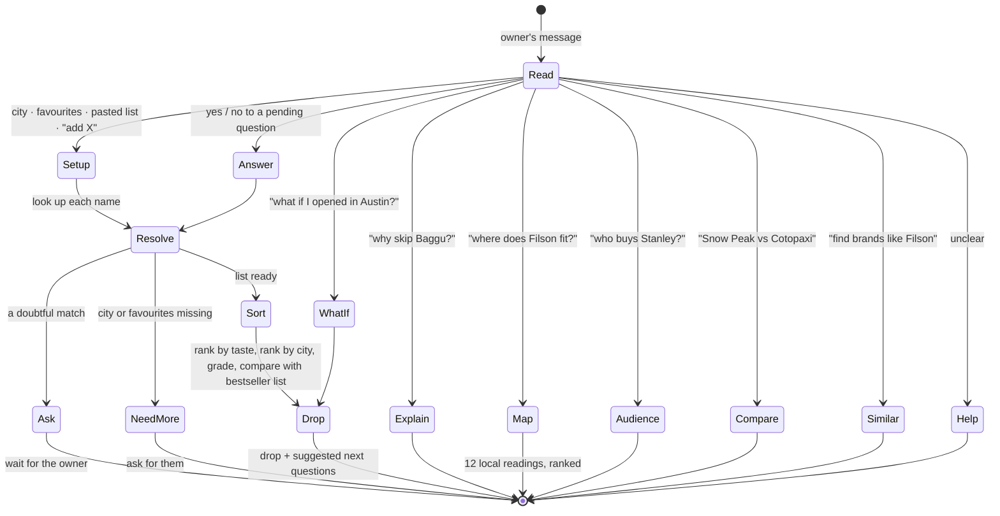
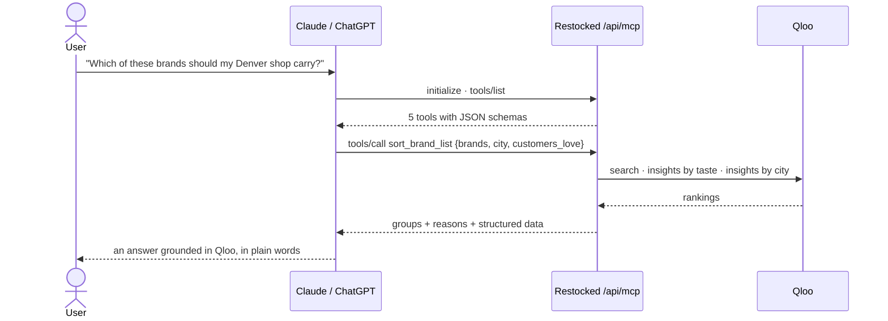

<div align="center">


# Restocked

### Know what pops before you buy.

**The buying agent for independent shops.** Paste a supplier's brand list, tell Restocked where your shop is and what
your customers already love, and every brand comes back sorted into **stock**, **consider** or **skip**, with the
evidence behind each call.

[**Live app**](https://restocked-beryl.vercel.app) · [**One-click demo**](https://restocked-beryl.vercel.app/app/demo) · [Sample shops](https://restocked-beryl.vercel.app/app/explore) · [Pricing](https://restocked-beryl.vercel.app/pricing) · [MCP endpoint](#use-it-from-your-ai-assistant)




</div>

---

## Contents

- [For judges: the 60-second path](#for-judges)
- [The problem](#the-problem)
- [What it does](#what-it-does)
- [How it works](#how-it-works)
  - [Architecture](#architecture)
  - [One drop, call by call](#one-drop-call-by-call)
  - [How a brand gets its call](#how-a-brand-gets-its-call)
  - [The agent's planner](#the-agents-planner)
- [Why it needs Qloo](#why-it-needs-qloo)
- [Does it hold up?](#does-it-hold-up)
- [Use it from your AI assistant](#use-it-from-your-ai-assistant)
- [Project map](#project-map)
- [Run it locally](#run-it-locally)
- [Limits, honestly](#limits-honestly)

---

## For judges

**Open [/app/demo](https://restocked-beryl.vercel.app/app/demo).** No sign-up. It loads a real drop for a Denver gift
shop, recorded from Qloo's API.

1. **Click any row** in the table to see why the brand landed there.
2. **Your call:** tick, question or cross on any row to overrule the agent.
3. **Order** turns the final calls into an email to the supplier's rep, sent from the owner's own mail app.
4. **Map** shows where a brand is strongest across 12 US cities.
5. **Qloo calls** lists every request behind the drop.
6. **Ask the agent** on the right: *"Why skip Baggu?"*, *"What if I opened in Austin?"*, *"Who buys Stanley?"*

| Criterion | Where to see it |
|---|---|
| **Technological implementation** | Seven Qloo capabilities used together: search, insights by taste, insights by city, explainability, demographics, audience compare and similar brands. Taste and place are asked as separate questions and combined by position ([`lib/grade.js`](lib/grade.js)). A paced, allow-listed Qloo client ([`lib/qloo.js`](lib/qloo.js)). An MCP server with 5 tools. 66 tests. |
| **Design** | A full workspace: set up the shop → paste a line sheet → watch the agent run → drop table → your calls → order draft → share link or CSV. Light and dark themes; works on phones. |
| **Potential impact** | 585,925 US retailers with fewer than 20 staff, selling $915B a year, commit cash to stock months ahead on instinct. The cost of inventory is their #2 problem out of 75 (NFIB). |
| **Quality of the idea** | Qloo on the *supply* side of retail: deciding what a shop buys, not what to recommend to a shopper. Checked against real stockist lists, three real shops and an LLM alone, with every result published ([below](#does-it-hold-up)). |
| **"Would it work without Qloo?"** | No. One supplier list sorted for four shops: a bestseller list gives all four the same answer; with Qloo, **21 of 23** brands get a different call depending on the crowd. |

---

## The problem

Independent shops place orders months ahead, usually on instinct and a sales rep's word. Sales history can't help with
a brand they have never carried, and a bestseller list knows nothing about *their* customers. A wrong buy becomes dead
stock and tied-up cash.

| | |
|---|---|
| **585,925** | US retail businesses with fewer than 20 employees, selling $915B a year ([US Census SUSB 2022](https://www2.census.gov/programs-surveys/susb/tables/2022/us_state_6digitnaics_2022.txt)) |
| **3.2M** | retail businesses across the EU with fewer than 20 employees ([Eurostat 2024](https://ec.europa.eu/eurostat/api/dissemination/statistics/1.0/data/sbs_sc_ovw)) |
| **#2 of 75** | cost of supplies and inventory, among small-business problems ([NFIB 2024](https://nfib.com/wp-content/uploads/2024/10/2024-Small-Business-Problems-Priorities.pdf)) |
| **+19%** | year-on-year growth in wholesale buying by independents ([Faire, Q2 2025 → Q2 2026](https://www.faire.com/news/faire-independent-retail-report-july-22-2026)) |

**The cost of buying wrong:** retailers lose **$1.73T** a year to inventory distortion, **$572B** of it overstock
([IHL Group 2025, via Board](https://www.board.com/resources/the-1-73-trillion-wake-up-call)), while the median small
retailer holds just **19 days** of cash in reserve ([JPMorgan Chase Institute](https://www.jpmorganchase.com/institute/all-topics/business-growth-and-entrepreneurship/report-cash-flows-balances-and-buffer-days)).

### Why this becomes a big company

| Tailwind | |
|---|---|
| **65%** of UK retail is independent; independents are over half of retail locations in every US state | [Faire, Jul 2026](https://investor.wedbush.com/wedbush/article/bizwire-2026-7-22-faire-unveils-first-of-its-kind-data-on-the-state-of-independent-retail) |
| **605** new US independent bookstores opened in 2025; ABA membership up 151% in six years | [ABA, May 2026](https://www.bookweb.org/node/1700609) |
| **$1T** of US retail revenue could come through AI agents by 2030 | [McKinsey via Digital Commerce 360](https://www.digitalcommerce360.com/2025/10/20/mckinsey-forecast-5-trillion-agentic-commerce-sales-2030/) |
| **600M+** entities and **30T+** connections in Qloo's taste graph | [Qloo](https://www.qloo.com/) |

| The category already builds big companies | |
|---|---|
| Faire, the wholesale marketplace for independents, valued at **$12.4B** | [BetaKit, 2021](https://betakit.com/faire-banks-400-million-usd-series-g-at-12-4-billion-valuation/) |
| Lightspeed bought NuORDER (B2B wholesale ordering) for **$425M** | [Retail Insider, 2021](https://retail-insider.com/retail-insider/2021/06/lightspeed-announces-acquisition-of-two-global-digital-commerce-businesses/) |
| Shopify merchants sold **$378B** in 2025 | [Shopify 10-K](https://www.sec.gov/Archives/edgar/data/1594805/000159480526000007/shop-20251231.htm) |

**The math on one plan:** 3,785,925 small retailers in the US and EU × the $29/month Shop plan → **$13.2M ARR at 1%**
adoption and **$65.9M at 5%**, before the brand side. Simple arithmetic, not a forecast. None of these companies helps a
shop decide what *its own crowd* will buy; that's the gap.

---

## What it does



| Feature | What the owner gets |
|---|---|
| **Drop** | Every brand on the list as stock, consider or skip, with its taste rank, local rank and what a bestseller list would have said |
| **Your call** | Tick, question or cross on any brand to overrule the agent |
| **Order** | A supplier email built from the final calls, plus a CSV order sheet |
| **Market map** | Where one brand is strongest across 12 US cities |
| **Discover** | Brands fans of your customers' favourites also love, minus the names everyone already carries |
| **What-if** | The same list re-run for another city, with what moves up and down |
| **Share** | A public link with a preview card for X and LinkedIn; the reasons stay private |

---

## How it works

### Architecture



- **The Qloo key never leaves the server.** It isn't sent to the browser, logged, or committed.
- **Conversation state travels with each message,** so the server holds no per-user session and scales like a static site.
- **One set of tools serves both doors.** The web agent and the MCP server call the same functions in [`lib/tools.js`](lib/tools.js).

### One drop, call by call



A 23-brand drop takes about **28 Qloo calls**: one lookup per name and favourite, then two rankings. A market map takes
**12**, one per city.

### How a brand gets its call

Two separate questions, because when a city is given Qloo only returns brands it has local data for, and a combined
question would silently drop the rest. Qloo's scores are only comparable inside one answer, so the grader uses
**positions** (top, middle or bottom third), never raw scores across answers.



Every call carries its reasons, for example:

> **Stanley · Stock.** Taste: 1st of 23 brands on this list among fans of what your customers love. The strongest link
> is to fans of Patagonia (34% of the match). Place: 10th of the 21 brands Qloo has a local reading for in Denver.
> *A generic bestseller list would say skip.*

### The agent's planner

The in-app agent plans with fixed rules rather than a language model. It needs no AI key, never invents a brand, and
every step is visible.



---

## Why it needs Qloo

| Question the owner has | Qloo capability |
|---|---|
| Is this the right brand? | `/search`, with exact, doubtful and unknown matches kept apart |
| Do fans of what my customers love also love this brand? | `/v2/insights` with `signal.interests.entities`, limited to the list |
| How does it rank in my city? | `/v2/insights` with `signal.location.query`, limited to the list |
| Why did it land there? | `feature.explainability`: which favourite drove the match |
| Where in the US does this brand fit? | `/v2/insights` with a location signal, one call per city |
| Who buys it? | `/v2/insights` with `filter.type=urn:demographics` |
| How do two audiences differ? | `/v2/insights/compare` plus demographics |
| What else does this crowd love? | `/v2/insights` for brands, leaving out the most famous |

**Without Qloo there's nothing to rank.** Here is the same supplier list sorted for four sample shops:

| Brand | Bestseller list (every shop) | Austin | Portland | Nashville | Los Angeles |
|---|---|---|---|---|---|
| Stanley | Skip | Stock | Consider | Stock | Skip |
| Aesop | Stock | Skip | Skip | Skip | Stock |
| Cotopaxi | Consider | Stock | Stock | Stock | Skip |
| Boy Smells | Skip | Consider | Consider | Stock | Stock |

**21 of 23** brands change call with the crowd. A popularity-only list can't change at all.

---

## Does it hold up?

### Against real stockists

Before building anything, we compared Qloo's city rankings with real public stockist lists for 7 brands (Filson, Snow
Peak, Stanley, Cotopaxi, Darn Tough, Rifle Paper Co., Herschel) across 12 US cities. After removing overall city and
brand effects:

| Measure | Result |
|---|---|
| Brand-by-city agreement with stockist density | **r = +0.32** over 84 brand-city pairs |
| Chance of that by luck (shuffle test) | about **1 in 1,000** |
| "Which cities suit this brand?" | average rank correlation **+0.64** |
| "Which brands suit this city?" | average rank correlation **+0.20** |

That last, weaker number is why the drop shows **groups**, not a precise order.

### Against three real shops, and against an LLM alone

We took the brands three real independent shops list on their own public brand pages
([`data/boutiques.json`](data/boutiques.json), copied 27 Oct 2026). For each shop we mixed brands it carries with
brands from our sample list that it doesn't. We gave Restocked the shop's city and its favourite brands (never scored),
then measured how often a carried brand was ranked above a not-carried one. This is the AUC: 0.5 is chance, higher is
better.

We ran the same test on **an LLM alone**: Claude, with no Qloo data, no web and no tools, given each shop's city, two
favourites and the same list, with names normalised so capital letters gave nothing away
([`data/llm-baseline.json`](data/llm-baseline.json)). Version 1 of Restocked lost to it, so we made two changes,
[declared in writing before re-running](data/method-v2.md): score with Qloo's full ranking instead of three groups,
and give Qloo all of the shop's favourites. Every number is below, including the ones that don't flatter us.

| Shop | Restocked v1 | Restocked v2 | LLM alone | Bestseller list |
|---|---|---|---|---|
| [Cumberland Transit](https://www.cumberlandtransit.com/pages/brands), Nashville · outdoor | 0.61 | **0.81** | 0.75 | 0.38 |
| [Stag Provisions](https://www.stagprovisions.com/pages/brands), Austin · menswear | 0.54 | 0.62 | **0.90** | 0.25 |
| [Pipe and Row](https://pipeandrow.com/pages/brands), Seattle · womenswear | 0.35 | 0.43 | **0.71** | 0.21 |
| **Average** | 0.50 | 0.62 | **0.79** | 0.28 |

**What this says, plainly:**
- Restocked beats a popularity-only list at all three shops.
- Version 2 beats the LLM alone at the outdoor shop, but loses at the other two. On average, the LLM alone is ahead on this test.
- This test mostly asks "is this the kind of brand this kind of shop carries?" A language model is good at that from general knowledge, and it may also simply know these real shops.
- Qloo is missing many of the small labels these shops carry, and the LLM was given two favourites where v2 had four.
- With 6 to 9 carried brands per shop, it's a small test.

Where Restocked is built to add what an LLM can't show, it does:
- **Every call is traceable** to a Qloo answer.
- **Brands Qloo doesn't know are never guessed.**
- **The answer changes city by city:** across our four sample shops, 21 of 23 calls change.
- **That city signal checks out** against real stockist lists (r = +0.32 above).

The honest next step is a hybrid: let a language model read the shop, and let Qloo ground and rank its picks.

Re-run everything with `node scripts/boutiques.mjs`, `node scripts/llm-baseline.mjs` and `node scripts/boutiques-v2.mjs`.

---|---|---|---|
| [Cumberland Transit](https://www.cumberlandtransit.com/pages/brands), Nashville · outdoor | 9 vs 20 | **0.61** | 0.38 |
| [Stag Provisions](https://www.stagprovisions.com/pages/brands), Austin · menswear | 8 vs 21 | **0.54** | 0.25 |
| [Pipe and Row](https://pipeandrow.com/pages/brands), Seattle · womenswear | 6 vs 21 | 0.35 | 0.21 |

- **Restocked beat the bestseller list at all three shops, and beat chance at two.**
- **Pipe and Row came out below chance.** Many of its brands are small labels Qloo doesn't know, and the brands it doesn't carry (Glossier, Aesop, Le Labo) suit its crowd well.
- With 6 to 9 carried brands per shop, this is a small test, not proof.

---

## Use it from your AI assistant

Restocked is also an **MCP server**. Add it to Claude, ChatGPT or any MCP client and the assistant gets the same tools
and the same data. The assistant does the talking; Restocked brings the taste data.

```json
{
  "mcpServers": {
    "restocked": { "type": "http", "url": "https://restocked-beryl.vercel.app/api/mcp" }
  }
}
```

| Tool | What it does |
|---|---|
| `sort_brand_list` | Stock, consider or skip for one shop; doubtful names come back for confirmation, never guessed |
| `find_similar_brands` | Brands fans of the given favourites also love, minus the most famous |
| `describe_audience` | Which age bands and gender a brand's audience leans towards |
| `map_brand_cities` | One brand's standing across 12 US cities |
| `compare_brands` | Two audiences side by side |



It supports protocol versions `2025-06-18`, `2025-03-26` and `2024-11-05`, uses stateless JSON responses, and returns
202 for notifications.

---

## Project map

```
app/
  page.js                 landing page (motion, live sorting demo, with/without Qloo)
  pricing/                plans and Qloo calls per action
  app/                    the workspace: overview, drops, new drop, agent, market map,
                          discover, sample shops, connect AI, settings, demo
  d/[code]/               public share page + generated preview image
  api/agent/route.js      the web agent endpoint
  api/mcp/route.js        the MCP server
lib/
  qloo.js                 Qloo client: allow-list, pacing, cache, retries, call trace
  agent.js · intent.js    the planner and the message reader
  tools.js                sort, similar, audience, compare, map
  grade.js · baseline.js  the grading rule and the bestseller-list comparison
  cities.js · crowds.js   market map ranking and the with/without Qloo comparison
  match.js                exact / doubtful / unknown name matching
  workspace.js            drops, calls, overview totals, CSV, order draft
  mcp.js · mcp-tools.js   JSON-RPC handling and tool wording
  share.js                share links that carry the drop
components/               app shell, drop table, order draft, city map, motion
scripts/
  examples.mjs            records the sample shops from the live API
  boutiques.mjs           the real-shop test
data/boutiques.json       three real shops' public brand lists
tests/                    66 tests (node:test)
```

---

## Run it locally

```bash
npm install
export QLOO_API_KEY=...        # a Qloo hackathon key; never commit it
npm test                       # 66 tests
npm run build && npm start     # http://localhost:3000
node scripts/examples.mjs      # re-record the sample shops from the live API
node scripts/boutiques.mjs     # re-run the real-shop test
```

**Engineering notes:**
- **Qloo answers 429 to parallel requests,** so the client sends one call at a time, with a 350 ms gap and retries after 1.5 s and 4 s.
- **Unknown parameters are refused before they reach Qloo,** because Qloo silently ignores them, which hides mistakes.
- **Answers are cached for 6 hours.**

**Stack:** Next.js 16 · React 19 · plain JavaScript · `motion` and `lenis` for the landing page · Vercel. No database
yet: workspaces are saved in the browser.

---

## Limits, honestly

- Rankings describe what groups of people tend to like. They are **not sales forecasts**.
- No data for India, and Qloo is missing about half of very small indie brands.
- The grouping rule hasn't been tested against actual sales.
- The in-app agent understands the phrasings shown in its suggestions; unusual wording gets a help message.
- No shop owner has used it yet. Workspaces live in the browser until accounts launch.

## Licence

[MIT](LICENSE). Built on Qloo's Taste AI API for the Qloo Agentic Hackathon 2026.
